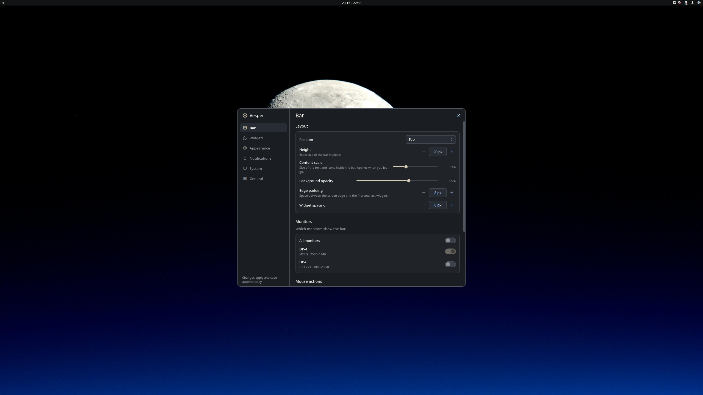
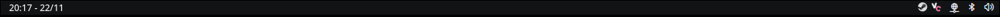

# Vesper

A simple, configurable bar for [Hyprland](https://hypr.land), built with [Quickshell](https://quickshell.org).



Vesper is inspired by noctalia-shell v4: a bar made of widgets you arrange from a settings window, with theming that only affects the bar itself. It deliberately leaves out the extras (wallpaper-based colours, app theming templates, dock, lock screen) to stay small and easy to follow.

## Features



- **Bar** on any edge of the screen, with an exact pixel height, separate content scale, background opacity, and per-monitor settings.
- **Widgets** you can add, remove, reorder and configure from the settings window:

  | Widget | |
  |---|---|
  | Workspaces | Click to switch; optionally only the current monitor's workspaces |
  | Active window | Icon and title of the focused window |
  | Clock | Any Qt date/time format; click for the calendar |
  | System tray | App tray icons with their menus |
  | Volume / Microphone | Click for the audio panel, middle click to mute, scroll to change |
  | Media | Now playing (MPRIS); play/pause, next, previous |
  | Bluetooth | Status; click for the Bluetooth panel, right click to turn on/off |
| Network / VPN | Wired and Wi-Fi status / VPN status; click for the network panel |
| Brightness | This screen's brightness (laptop backlight or external monitor over DDC/CI); scroll to change |
| System monitor | CPU, memory, temperatures, GPU, disk and network speed |
| Night light / Keep awake | Click to toggle |
| Privacy indicator | Shows while apps use the microphone, camera or screen sharing |
| Notifications | Unread count; click for the history, right click for do not disturb |
| Control center | Opens the control center |
  | Battery | Hidden on machines without a battery |
  | Power profile | Switch between power saver, balanced and performance |
  | Keyboard layout | Click to switch layout |
  | Lock keys | Caps / Num / Scroll Lock indicators |
  | Custom button | Your own icon, label and commands |
  | Text | Fixed text or a command's output |
  | Spacer, Settings button, Session button | |

- **Panels** that open from the bar:
  - **Calendar**: month view, optional week numbers.
  - **Audio**: output and input volume, pick the default device, per-app volume.
  - **Control center**: volume, mic and brightness sliders, network / Bluetooth / do not disturb / power profile / night light / keep awake toggles, the current media player, and shortcuts to settings and the session menu.
  - **Network**: wired status, Wi-Fi on/off and networks (with password entry), VPN connections.
  - **Bluetooth**: on/off, connect and disconnect paired devices, pair new ones.
  - **Notification history**, with do not disturb.
- **Notifications**: Vesper is a notification daemon, with popups (actions, images, links, replacing notifications) and a history that's kept across restarts.
- **On-screen display** when the volume, microphone or brightness changes.
- **Night light** (with an optional schedule) and **keep awake**.
- **Session menu**: suspend, log out, reboot, shut down (and lock, if you set a lock command), with keyboard shortcuts and a countdown before destructive actions.
- **Settings window** for everything above. Changes apply immediately and are saved to a plain JSON file, which also reloads live if you edit it by hand.
- **Themes**: Catppuccin Mocha and Latte, Compline and Lauds, Gruvbox Dark, Nord, Rosé Pine and Tokyo Night built in, plus your own.
- **Configurable bar actions**: what scrolling, right-clicking and middle-clicking empty bar space does. Scrolling can step once per wheel notch or once per swipe.
- **IPC** commands for keybinds.

## Requirements

- **Hyprland** with a **Lua config** (`hyprland.lua`). Other compositors and the older `hyprland.conf` format aren't supported.
- **Quickshell** 0.3 or newer.
- **PipeWire** for the volume and microphone widgets, the audio panel and the OSD.

Optional, for the widgets that use them:

- **NetworkManager** (Network and VPN widgets, network panel)
- **BlueZ** (Bluetooth widget and panel)
- **ddcutil** for external monitor brightness (the monitor needs DDC/CI on; you may need to load the `i2c-dev` module), **brightnessctl** for laptop screens
- **hyprsunset** for night light. Vesper starts and stops it, so don't also run it yourself.
- **UPower** (Battery widget) and **power-profiles-daemon** (Power profile widget)
- **pavucontrol**, which the volume and microphone widgets open on right click by default (changeable)

Vesper is a notification daemon, so stop any other one (mako, dunst, swaync, another shell). If one is running, Vesper waits and takes over once it exits. To keep your own daemon, turn off Settings → Notifications → Receive notifications.

## Installation

Quickshell loads configs from `~/.config/quickshell/<name>/`. Clone Vesper there:

```sh
git clone https://github.com/TheyCallMePBJ/vesper.git ~/.config/quickshell/vesper
```

(If you'd rather keep the code elsewhere, clone it anywhere and symlink that folder to `~/.config/quickshell/vesper`.)

Try it out:

```sh
qs -c vesper
```

To start it with Hyprland, add it to your autostart, for example in `autostart.lua`:

```lua
hl.on("hyprland.start", function()
  hl.exec_cmd("qs -c vesper")
end)
```

### Updating

```sh
git -C ~/.config/quickshell/vesper pull
```

Your settings live separately in `~/.config/vesper/`, so updating never touches them. When the settings format changes, Vesper upgrades your file automatically.

## Configuration

Open the settings window with the settings button on the bar, from the control center, by right-clicking empty bar space (the default action), or with `qs -c vesper ipc call settings toggle`.

Settings are stored in `~/.config/vesper/settings.json` (notification history in `~/.local/state/vesper/notifications.json`). The file only contains what you've changed; everything else uses the defaults. You can edit it by hand and Vesper picks up changes immediately. If the file has a mistake, Vesper keeps the last working settings and logs a warning.

### Custom themes

Put a JSON file in `~/.config/vesper/themes/`, for example `~/.config/vesper/themes/my-theme.json`:

```json
{
  "name": "My Theme",
  "colors": {
    "background": "#1e1e2e",
    "surface":    "#313244",
    "surfaceAlt": "#45475a",
    "border":     "#585b70",
    "text":       "#cdd6f4",
    "textMuted":  "#7f849c",
    "accent":     "#cba6f7",
    "onAccent":   "#1e1e2e",
    "success":    "#a6e3a1",
    "warning":    "#f9e2af",
    "error":      "#f38ba8"
  }
}
```

It then appears in Appearance → Theme. Any colour you leave out falls back to the default theme. A custom theme with the same file name as a built-in one (e.g. `nord.json`) replaces it. Edits to the selected theme's file apply live.

| Colour | Used for |
|---|---|
| `background` | Bar and panel background |
| `surface` / `surfaceAlt` | Cards, inputs and hover / pressed states |
| `border` | Outlines and dividers |
| `text` / `textMuted` | Main and secondary text (e.g. inactive workspaces) |
| `accent` / `onAccent` | Highlights (focused workspace, toggles) and text drawn on them |
| `success` / `warning` / `error` | Status colours |

### Session commands

Lock, suspend, log out, reboot and shut down run configurable commands (Settings → General). Vesper has no lock screen of its own, so the Lock button only appears once you set a lock command such as `hyprlock`. Logging out exits Hyprland unless you set a command.

## IPC

Call these with `qs -c vesper ipc call <target> <function>`, e.g. in `binds.lua`:

```lua
hl.bind("SUPER + COMMA", hl.dsp.exec_cmd("qs -c vesper ipc call settings toggle"))
hl.bind("XF86AudioRaiseVolume", hl.dsp.exec_cmd("qs -c vesper ipc call volume up"))
hl.bind("XF86MonBrightnessUp", hl.dsp.exec_cmd("qs -c vesper ipc call brightness up"))
```

| Target | Functions |
|---|---|
| `settings` | `toggle`, `open`, `close`, `openTab <name>`, `reload` |
| `session` | `toggle`, `open`, `close` |
| `calendar` | `toggle`, `open`, `close` |
| `audio` | `toggle`, `open`, `close` |
| `controlCenter` | `toggle`, `open`, `close` |
| `network` | `toggle`, `open`, `close`, `toggleWifi` |
| `bluetooth` | `toggle`, `open`, `close`, `togglePower` |
| `brightness` | `up`, `down`, `set <0-100>`, `get`, `list`, `refresh` (focused monitor) |
| `nightLight` | `toggle`, `enable`, `disable`, `isActive` |
| `keepAwake` | `toggle`, `enable`, `disable`, `isEnabled` |
| `notifications` | `toggle`, `open`, `close`, `toggleDnd`, `setDnd <true/false>`, `clear`, `dismissPopups` |
| `volume` | `up`, `down`, `toggleMute`, `set <0-100>`, `get` |
| `mic` | `up`, `down`, `toggleMute` |
| `media` | `playPause`, `next`, `previous` |

The volume step is set in Settings → General. Panels opened by IPC appear next to their bar widget on the focused monitor if it has one (e.g. the calendar under the clock). `notifications dismissPopups` hides the current popups; they stay in the history. Tab names for `openTab` are `bar`, `widgets`, `appearance`, `notifications`, `system` and `general`.

## Credits

- [Tabler Icons](https://tabler.io/icons) by Paweł Kuna (MIT, see `Assets/fonts/tabler-icons-LICENSE.txt`).
- The Compline and Lauds themes use the [Compline](https://github.com/joshuablais/compline) palettes by Joshua Blais.
- Inspired by [noctalia-shell](https://github.com/noctalia-dev) v4.

## License

Vesper is free software, licensed under the [GNU General Public License v3.0](LICENSE) or (at your option) any later version.

The bundled Tabler Icons font keeps its own MIT license.
